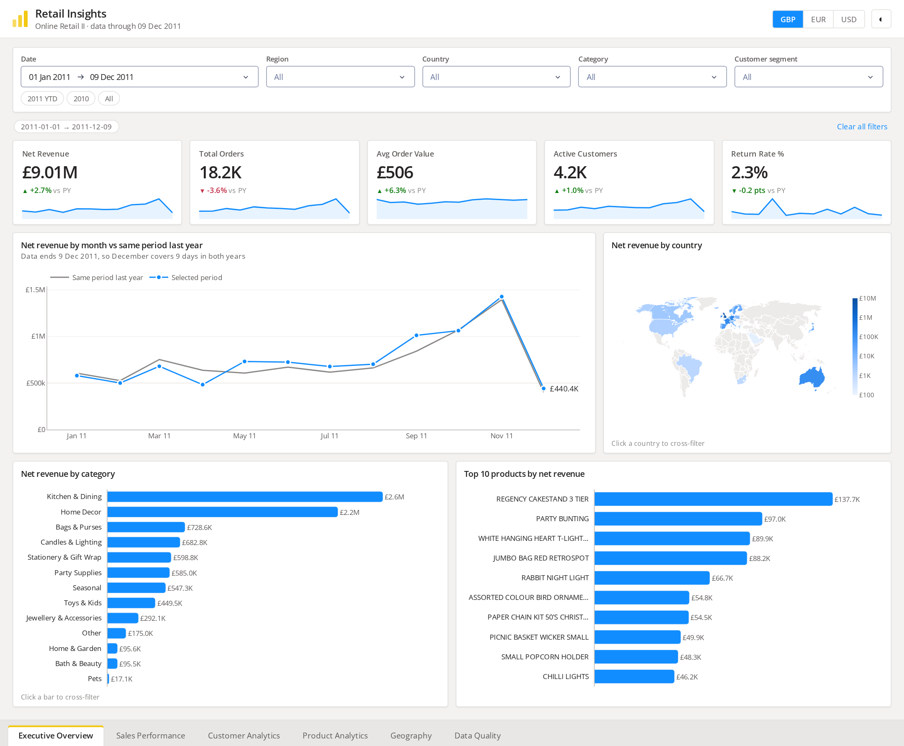
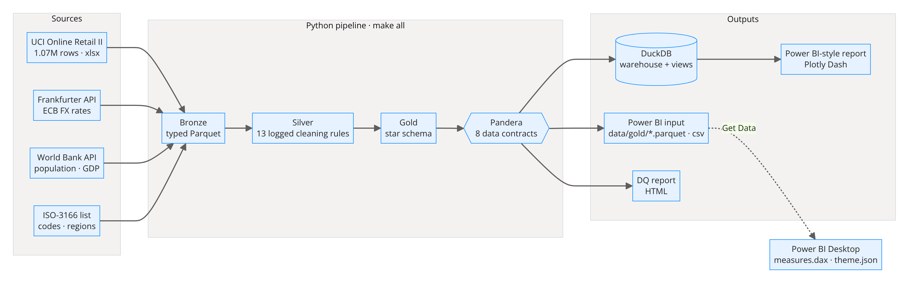
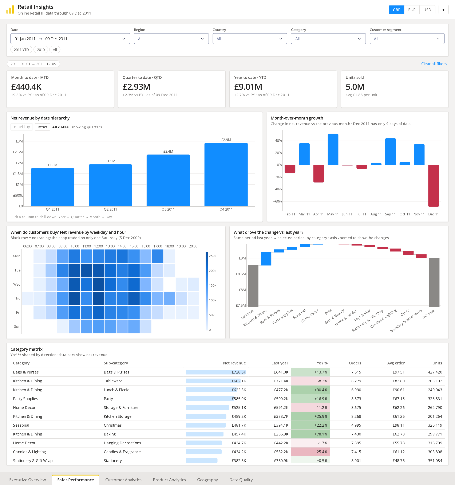
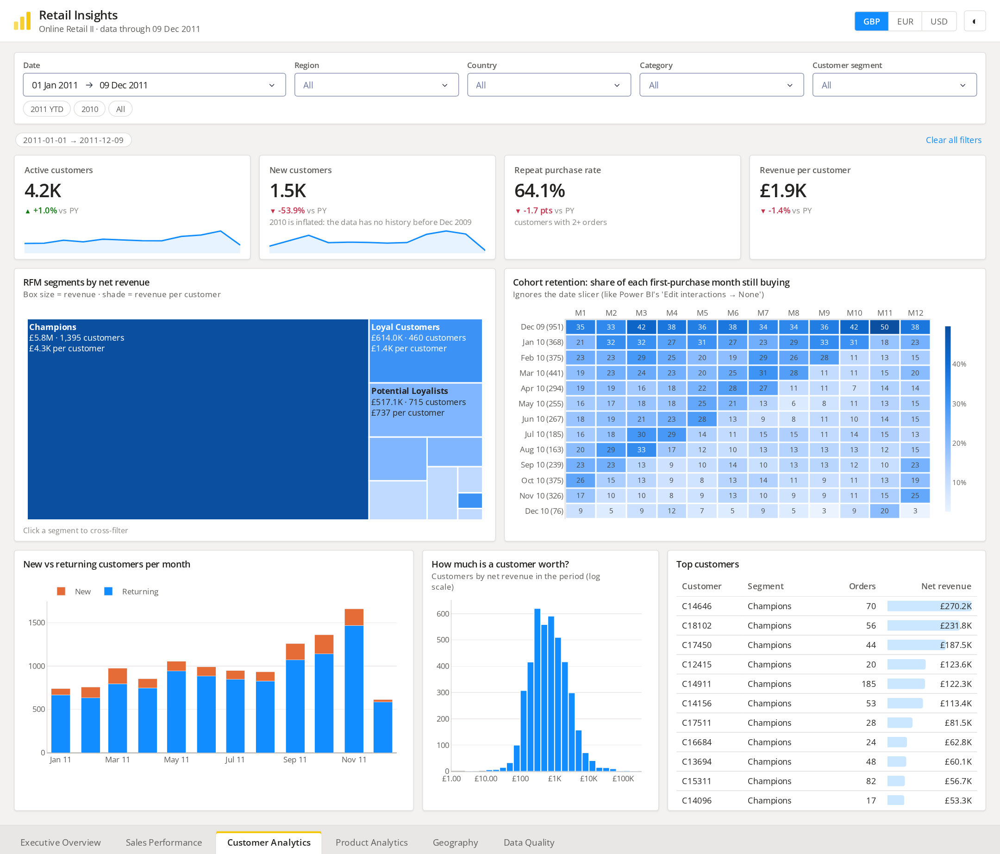
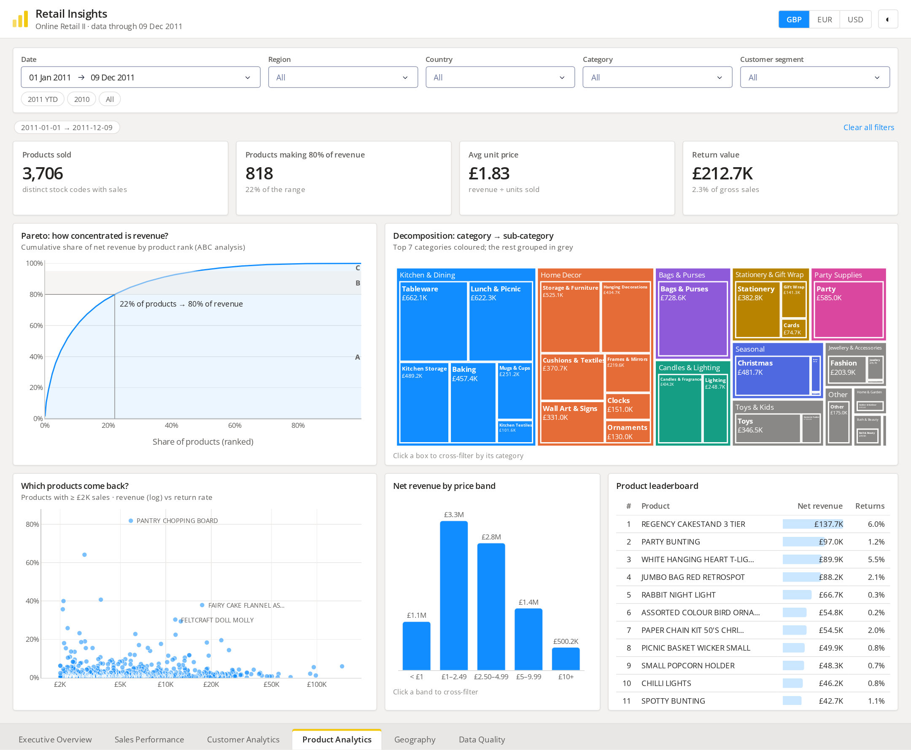
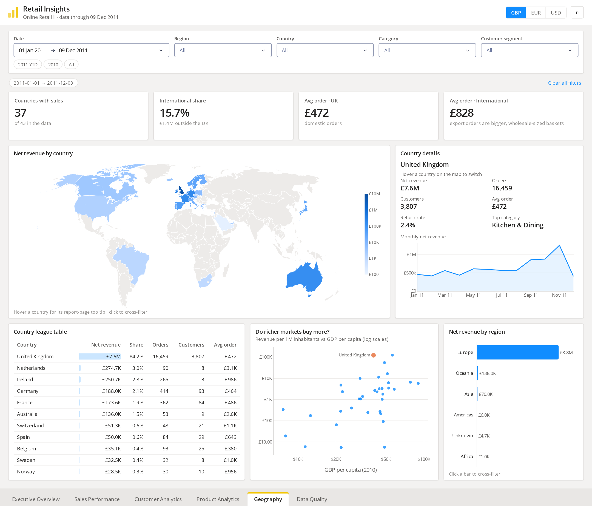
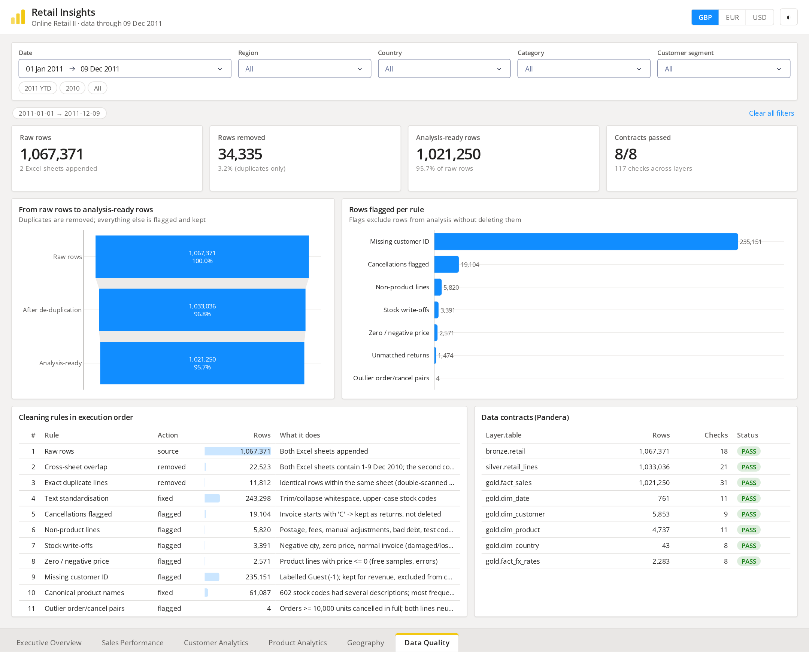
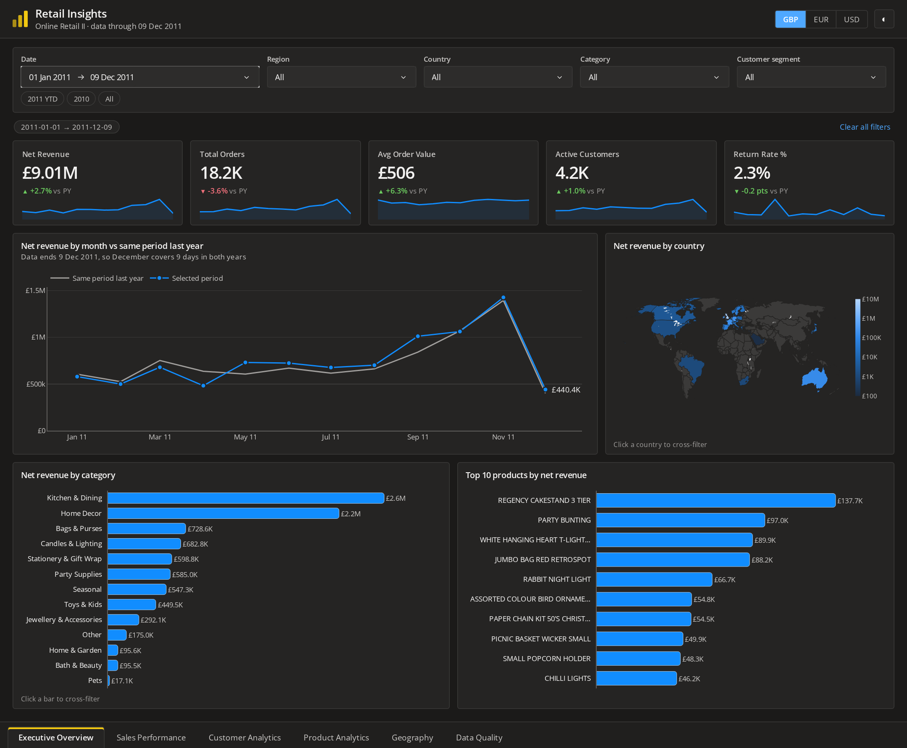

# Retail Insights: an end-to-end Power BI project

**1.07 million real e-commerce transactions → a cleaned and validated star schema → DAX measures → a 6-page interactive report.**

The pipeline runs on Linux, where Power BI Desktop isn't available. The report is therefore built twice from the same model and theme: once as Power BI assets (star schema, `measures.dax`, Power Query M scripts, `theme.json`) and once as a working web replica of the Power BI report. The replica has synced slicers, cross-filtering, drill-down, report-page tooltips, focus mode and export to CSV.



---

## What's in it

| Power BI skill | Where to find it |
|---|---|
| **Get Data** from files and REST APIs | [`src/retail_bi/ingest/`](src/retail_bi/ingest/): idempotent downloads with retries, checksums and a lineage manifest |
| **Power Query** transforms | [`src/retail_bi/transform/`](src/retail_bi/transform/) (Python), mirrored in M in [`powerbi/power_query/`](powerbi/power_query/) |
| **Data modelling** (star schema) | [`data/gold/`](data/gold/) · [`powerbi/data_model.md`](powerbi/data_model.md) |
| **DAX** (39 measures: time intelligence, RANKX, Pareto, cohorts, dynamic titles) | [`powerbi/measures.dax`](powerbi/measures.dax) |
| **Report design** (theme, layout, interactions) | [`powerbi/theme.json`](powerbi/theme.json) · [`dashboard/`](dashboard/) |
| **Data quality** | 13 logged cleaning rules, 8 Pandera data contracts, [HTML report](docs/data_quality_report.html), and an in-report Data Quality page |
| **Testing** | 48 tests: cleaning rules, star-schema integrity, measure correctness, and browser tests of every interaction |

## Architecture



| Layer | What happens | Output |
|---|---|---|
| **Ingest** | UCI Online Retail II (xlsx, 45 MB), ECB FX rates (Frankfurter API), population and GDP (World Bank API), ISO-3166 country list | `data/raw/` + `_manifest.json` (URL, timestamp, SHA-256) |
| **Bronze** | Both Excel sheets appended, columns renamed and **explicitly typed** (`Invoice` must be text, or the "C" cancellation prefix is lost) | `data/bronze/*.parquet` |
| **Silver** | 13 cleaning rules, each logged with the number of rows it affected (see below) | `data/silver/retail_lines.parquet` |
| **Gold** | Enrichment (FX, geography, RFM, ABC), surrogate keys, referential-integrity checks | `data/gold/*.parquet` (+ CSV), the **Power BI input** |
| **Validate** | Pandera contracts on bronze, silver and every gold table | build fails on any violation |
| **Warehouse** | DuckDB with the star schema, analytical SQL views and DQ tables | `warehouse/retail.duckdb` |

### Data cleaning highlights

| Issue found while profiling the raw data | Rows | Treatment |
|---|---:|---|
| The two Excel sheets **overlap** (both contain 1–9 Dec 2010) | 22,523 | removed |
| Exact duplicate lines within a sheet | 11,812 | removed |
| Missing customer ID | 235,151 | kept for revenue as **Guest (-1)**, excluded from customer analytics |
| Cancellations (`C` invoices) | 19,104 | kept as **returns**, so net revenue is honest |
| Postage, fees, manual adjustments, bad debt (`A` invoices), test codes | 5,820 | flagged, excluded from product sales |
| Stock write-offs (negative quantity, zero price, normal invoice) | 3,391 | flagged |
| Same product with several descriptions | 602 codes | most frequent description becomes the canonical name |
| 80,995-unit and 74,215-unit orders cancelled minutes later | 4 | order/cancel pair neutralised |
| Country labels like `EIRE`, `RSA`, `Channel Islands` | | mapped to ISO-3166, with a hard failure on any unknown label |
| No product category in the source | 4,737 products | keyword rules ([`config/categories.yaml`](config/categories.yaml)) categorise **94% of products and 97% of revenue** |

Only duplicates are deleted (3.2% of rows); everything else is flagged and kept, which is how a production pipeline should behave.

## Data model


One fact table at invoice-line grain (1.02M rows) and four conformed dimensions. All relationships are one-to-many with single-direction filters on integer surrogate keys. A continuous date table supports time intelligence. A disconnected `dim_currency` table drives a GBP/EUR/USD switch, the same way a field parameter would. Details: [`powerbi/data_model.md`](powerbi/data_model.md).

## DAX

[`powerbi/measures.dax`](powerbi/measures.dax) contains 39 documented measures in display folders. The core measures have Python twins with the same names in [`measures.py`](src/retail_bi/measures/measures.py), which power the web report and are tested against hand calculations. For example:

```DAX
Net Revenue YoY % =
DIVIDE ( [Net Revenue YoY], [Net Revenue PY] )

Cumulative Revenue % =                       -- Pareto / ABC curve
VAR _current = [Net Revenue]
VAR _total   = CALCULATE ( [Net Revenue], ALLSELECTED ( dim_product ) )
VAR _running =
    SUMX ( FILTER ( ALLSELECTED ( dim_product[product_name] ),
                    CALCULATE ( [Net Revenue] ) >= _current ),
           CALCULATE ( [Net Revenue] ) )
RETURN DIVIDE ( _running, _total )
```

## Key insights

1. **Growth came from bigger baskets, not more orders.** 2011 YTD net revenue is **£9.01M, up 2.7%** on the same period of 2010, while orders fell 3.6% and average order value rose 6.3%.
2. **The business is a Q4 business.** September–November produced **41%** of Jan–Nov 2011 revenue, and November 2011 was the best month in the data (£1.43M).
3. **Champions carry the company.** The RFM *Champions* segment is **24% of customers but 70% of revenue**, so retaining them matters more than acquiring new customers.
4. **Revenue is concentrated.** In 2011, **22% of products made 80% of revenue** (ABC analysis), so the C-class tail is a candidate for range rationalisation.
5. **Export orders are bigger.** International orders average **£856 vs £458** for the UK. The UK is still 85% of revenue, which leaves room to grow abroad.
6. **Lunchtime midweek is peak time.** The busiest hour is **Wednesday 12:00**. The shop traded on only one Saturday in two years.
7. **Returns are low** (2.3% of gross sales). The best-selling Regency Cakestand is also the most-returned item by value (£16.5K).

## The report

The six pages are listed below. Light/dark mode, GBP/EUR/USD, and phone layouts are supported.

| | |
|---|---|
| **Sales Performance**: MTD/QTD/YTD, Year→Quarter→Month→Day drill-down, MoM, weekday×hour heatmap, YoY waterfall, conditional-format matrix  | **Customer Analytics**: RFM treemap, cohort retention heatmap, new vs returning customers, customer value distribution  |
| **Product Analytics**: Pareto/ABC curve, decomposition treemap, returns scatter, price bands, leaderboard  | **Geography**: map with report-page tooltip, league table, revenue per capita vs GDP  |
| **Data Quality**: row funnel, flags per rule, rule log, data contracts  | **Dark mode**  |

**Power BI behaviours recreated:**
- slicers synced across pages
- cascading Region → Country slicer
- click-to-cross-filter, with highlight on the source visual and toggle-off on a second click
- drill-down and drill-up on the date hierarchy
- "Edit interactions → None" on the cohort matrix
- report-page tooltip
- focus mode
- export data to CSV
- filter chips and Clear all
- page tabs at the bottom

## Run it

You need [uv](https://docs.astral.sh/uv/), and nothing else.

```bash
make all          # download → clean → model → validate → warehouse (≈1 min after the first download)
make dashboard    # http://127.0.0.1:8050
make test         # unit + data tests
make test-e2e     # browser tests (first: uv run playwright install chromium)
```

To open it in **Power BI Desktop**, follow [`powerbi/REBUILD_IN_POWERBI.md`](powerbi/REBUILD_IN_POWERBI.md). It covers importing `data/gold/`, relationships, measures, the theme and the page-by-page visual mapping, plus running Power BI in a Windows VM on Linux.

To **deploy** the live demo, use the `Dockerfile`. It builds the pipeline inside the image and serves the report with gunicorn on port 7860, which fits a Hugging Face Space with the Docker SDK.

## Project layout

```
config/            settings.yaml (URLs, business rules) · categories.yaml (category keyword rules)
src/retail_bi/     ingest/ → transform/ (bronze, silver, enrich) → model/ (gold, warehouse, sql/) → validate/ → measures/
powerbi/           measures.dax · theme.json · power_query/*.pq · data_model.md · REBUILD_IN_POWERBI.md
dashboard/         app.py · pages/ (6 report pages) · components/ · charts.py · assets/powerbi.css
data/gold/         the star schema (Parquet committed; CSV regenerated)
docs/              data_quality_report.html · images/
tests/             cleaning rules · integrity + measures · browser e2e
```

## Data sources and licences

- Chen, D. (2012). *Online Retail II* [Dataset]. UCI Machine Learning Repository. https://doi.org/10.24432/C5CG6D (CC BY 4.0)
- Exchange rates: European Central Bank via [Frankfurter](https://frankfurter.dev)
- Population and GDP per capita: [World Bank Open Data](https://data.worldbank.org) (CC BY 4.0)
- ISO-3166 codes and regions: [lukes/ISO-3166-Countries-with-Regional-Codes](https://github.com/lukes/ISO-3166-Countries-with-Regional-Codes)
