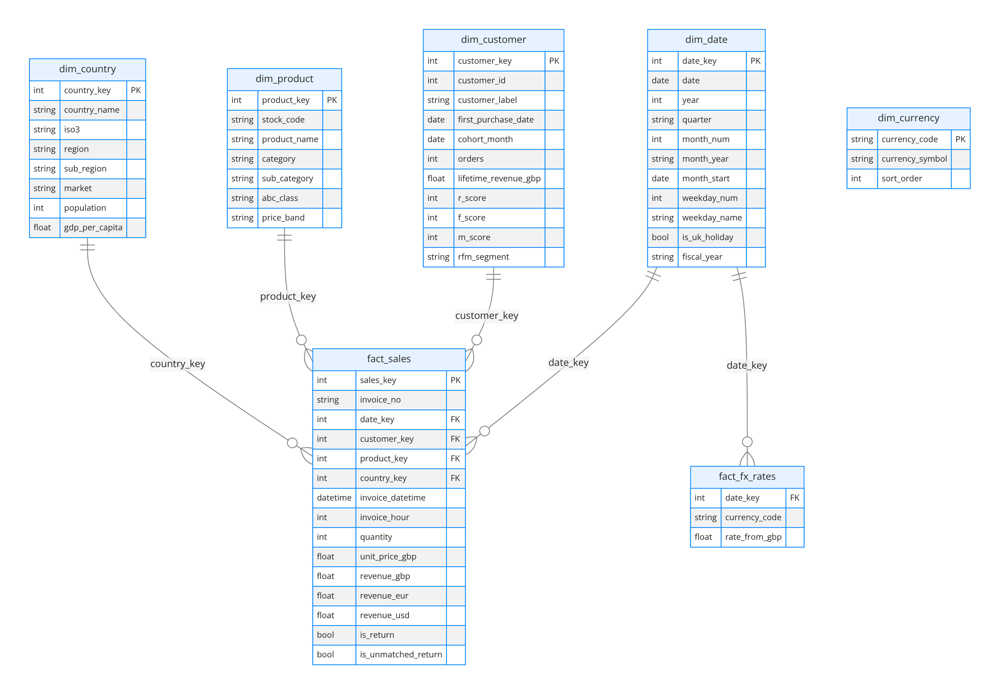
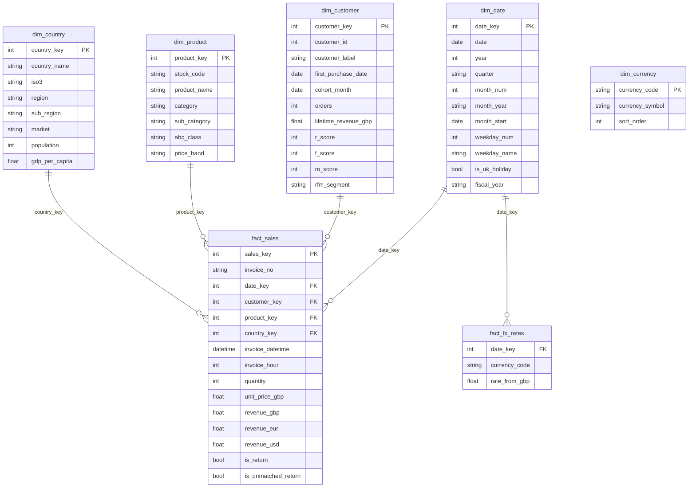

# Data model

A classic **star schema**: one fact table at invoice-line grain, four conformed dimensions, plus a small FX fact and a disconnected currency table that drives the currency slicer.

## Relationships

| From (many) | To (one) | Cardinality | Cross-filter | Active |
|---|---|---|---|---|
| `fact_sales[date_key]` | `dim_date[date_key]` | * : 1 | Single | ✔ |
| `fact_sales[customer_key]` | `dim_customer[customer_key]` | * : 1 | Single | ✔ |
| `fact_sales[product_key]` | `dim_product[product_key]` | * : 1 | Single | ✔ |
| `fact_sales[country_key]` | `dim_country[country_key]` | * : 1 | Single | ✔ |
| `fact_fx_rates[date_key]` | `dim_date[date_key]` | * : 1 | Single | ✔ |
| `dim_currency` | — | disconnected | — | used by `SELECTEDVALUE` in `[Net Revenue]` |

## Table notes

| Table | Grain | Rows | Notes |
|---|---|---:|---|
| `fact_sales` | one invoice line | ~1.02M | Product sales **and** returns (`is_return`, negative quantity). Postage, fees, adjustments and test lines are excluded upstream and documented in the data quality report. |
| `dim_date` | one day | 761 | Continuous 1 Dec 2009 → 31 Dec 2011, as Power BI time intelligence requires. **Mark as date table.** UK bank holidays and an April fiscal year included. |
| `dim_customer` | one customer | 5,853 | Includes a `-1 Guest` row for the ~23% of lines without a customer ID. RFM scores (1–5) and segment were computed at the end of the data window. |
| `dim_product` | one stock code | 4,737 | Canonical name (most frequent description), keyword-derived category, ABC class (A = top 80% of revenue), price band. |
| `dim_country` | one country | 43 | ISO codes, UN region, World Bank population and GDP per capita (2010). Four labels are not ISO countries (Channel Islands, European Community, West Indies, Unknown). |
| `fact_fx_rates` | day × currency | 2,283 | ECB rates via Frankfurter, forward-filled over weekends. Revenue in EUR/USD is pre-computed per line at the invoice date's rate. |

## Modelling decisions

- **Surrogate integer keys** for every dimension: smaller and faster than text keys in VertiPaq.
- **Single-direction filters only**: no bi-directional relationships, so there is no ambiguity.
- **Returns stay in the fact table** with a flag. Deleting them would overstate revenue, so `Total Revenue`, `Return Value` and `Net Revenue` separate them instead.
- **Currency conversion is done at line level in the pipeline**, which is accurate to the daily rate and avoids an expensive iterator in DAX. `fact_fx_rates` remains in the model for anyone who wants to recompute it in DAX.
- **Sort-by columns**: `month_year` → `month_start`, `weekday_name` → `weekday_num`, `quarter` → `quarter_num`.
